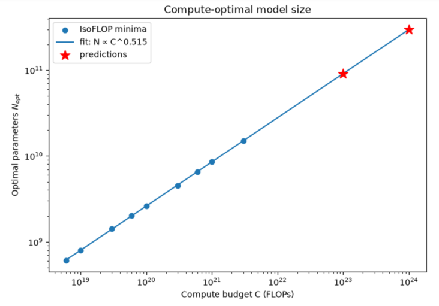
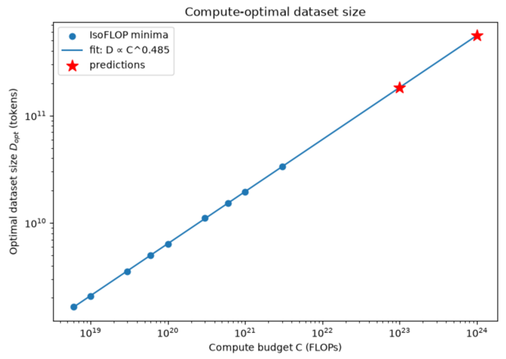

# CS336 Assignment 3 — Written Answers

## 2.1 Problem (chinchilla_isoflops): IsoFLOPs scaling laws

**(a)**

By fitting linear function into minima of constant compute sweeps my optimal model sizes are:
- 9.114e+10 params for 1e23 FLOPs
- 2.981e+11 params for 1e24 FLOPs

**(b)**

By approximating D ≈ C / 6N and fitting a linear function I received:
- 1.829e+11 tokens for 1e23 FLOPs
- 5.592e+11 tokens for 1e24 FLOPs
